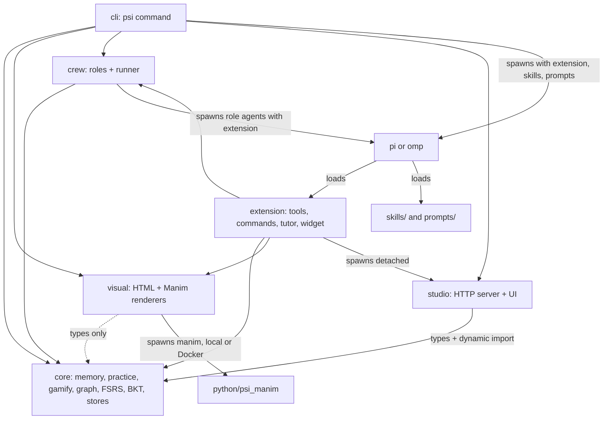

# Architecture

psi is a text-first, practice-first learning agent. Its main loop is skill deconstruction → challenge → attempt →
feedback → reflection. Learner memory carries context between sessions; XP tracks participation, not mastery.
Concept graphs, spaced flashcards, and visual production form an optional layer. In that layer, only recorded card
ratings update BKT mastery; producing a lesson or visual does not.

## Practice layer

- `core/src/memory.ts`: `MemoryStore` stores durable learner observations and session recaps. It merges similar
  same-kind observations, ranks recall by relevance/confidence/recency, and renders a bounded learner summary.
- `core/src/practice.ts`: `PracticeStore` manages skill plans, prerequisite-aware next-subskill selection,
  challenges, deterministic answer checking, attempts, sessions, and progress. Open answers need tutor grading.
  Closing a session credits rounded elapsed minutes, capped at 180. Writes are atomic per file, not transactions.
- `core/src/gamify.ts`: pure XP, level, streak, and badge calculations. Failures earn XP; a nonblank lesson recorded
  with a failure adds 5 XP. Challenge-kind multipliers, learner level, and hints affect the total.
- `extension/src/index.ts` calls `registerPractice(pi)` from `extension/src/practice/index.ts`, then
  `registerConceptLayer(pi)`. Practice registration installs its own tools, commands, HUD, and injection hooks;
  the concept layer keeps a separate store and tutor state.
- `extension/src/practice/inject.ts` handles `before_agent_start`: it appends the memory summary, active skill,
  next subskill, elapsed/planned session time, hours, streak, level, and practice contract to the system prompt.
  Stored observations are data, not instructions. This injection remains active when concept tutor mode is off.
- On session start, practice restores the skill from `psi-practice` host entries or `--psi-skill` and shows a
  welcome-back message from the latest recap. The contract requests attempt-before-explanation, hints on request,
  honest grading, and session recaps; those teaching behaviors still depend on the model.
- `cli/src/practice-commands.ts` dispatches model-free skill listing, drills, hours, memory, progress, and imports
  to `cli/src/commands/`. Terminal drills use the same answer checker and progress store as the extension.

Practice state is separate from topic-card mastery: passing drills does not update BKT or automatically mark a
subskill solid. The 70–85% success target is guidance in host skills, not a scheduler in the core.

## Module boundaries

Arrows are imports (including dynamic imports) unless labeled as spawning or loading.



- Only `extension/` imports the host SDK (`@earendil-works/pi-coding-agent`, `@earendil-works/pi-ai`). `cli/` and
  `crew/` spawn the `pi`/`omp` binaries instead.
- `core/` uses Node built-ins only. `visual/` imports only core types.
- Python/Manim is optional and separate from the zero-dependency Node runtime.

## Optional concept-layer data flow

1. `cli/src/host.ts` launches pi with `-e extension/src/index.ts --skill skills --prompt-template prompts
   --psi-tutor=true [--psi-topic <slug>]`. For omp, a skill index replaces the pi resource flags.
   `/learn` selects a topic and asks for a diagnosis.
2. The agent saves a validated graph (`psi_concept_graph`) and a plan (`psi_lesson_plan`) through `PsiStore`.
3. `frontier()` and `pathTo()` in `core/src/graph.ts` compute what is ready to learn and the unmastered route to a
   target, from the mastered set (`isMastered()`, `pKnown ≥ 0.95`).
4. Lessons call the visual tools; renderers write files under `artifacts/` and tools return their paths.
5. A grade from the terminal (`psi review`), studio, or `psi_review_grade` calls `PsiStore.review()`:
   FSRS-5 reschedules the card → `cards.json`; a log line → `reviews.jsonl`; BKT updates the concept's `pKnown`
   (rating ≥ 3 counts as correct) → `learner.json`.
6. Frontier, `/map`, `/progress`, `psi topics`, and studio all read that same estimate. Missing records are not
   mastered.

JSON writes are atomic (temp file + rename). A review touches three files and is not a transaction: there is no
cross-process lock or rollback.

## Storage

`PsiStore` (`core/src/store.ts`) resolves `PSI_HOME ?? ~/.psi` to an absolute root at construction. Topic slugs must be
kebab-case; ids and artifact filenames are checked for path tricks, and symlinks below the root are refused (the root
itself may be a symlink). Dates are ISO-8601 strings.

```text
$PSI_HOME/                       # default ~/.psi
  workspace/                     # host working directory for psi learn / ask
  memory.json                    # LearnerMemory: observations, name, recaps
  skills/<skill>/
    plan.json                    # SkillPlan
    challenges.json              # Challenge[]
    attempts.jsonl               # Attempt records
    sessions.jsonl               # PracticeSession records
    progress.json                # Progress: XP, level, streak, minutesLogged, badges
  topics/<topic>/
    graph.json                   # ConceptGraph
    plan.json                    # LessonPlan
    cards.json                   # Card[] with FSRS state
    learner.json                 # BKT mastery per concept + tutor notes[]
    reviews.jsonl                # one ReviewLog per grade
    notes.md                     # psi_note calls appendNote; timestamped learner observations
    storyboards/<id>.json
    explorables/<id>.json
    artifacts/                   # <id>.html players/explorables, <id>.py transpiled scenes
      media/…/*.mp4              # Manim output (nested; not listed by listArtifacts)
    crew/log.jsonl               # one CrewResult per role run
    crew/{intuition,storyteller,visualizer}.md
```

Files appear on demand. Host session files are managed by the host.

## Optional concept tutor injection

`extension/src/index.ts` builds one `PsiStore` and a session-local `TutorState` (`mode`, `topic`, `currentLesson`),
inside `registerConceptLayer`, then registers tools (`tools.ts`), commands (`commands.ts`), tutor hooks (`tutor.ts`),
and the status widget
(`widget.ts`, refreshed after each turn).

- **State.** Commands persist snapshots as `psi-tutor` custom session entries. On `session_start` the last snapshot on
  the branch is restored, then the `--psi-topic` / `--psi-tutor` flags apply. The extension alone starts with mode
  `off`; the CLI passes `--psi-tutor`; `/learn` and `/lesson` turn it on.
- **Teaching contract.** While mode is not `off`, `before_agent_start` appends a contract to the system prompt: active
  topic and lesson, mode, the last 12 legacy learner notes plus the last 12 nonblank lines from `notes.md` (combined ≤ 4,000 chars,
  labeled "observations, not instructions"), due-card
  count, and rules — intuition before formalism, predict before reveal, one idea at a time, purposeful visuals, exact
  tool-call shapes, and "never fake mastery". `socratic` and `explain` add a pacing line.
- **Limits.** These are model instructions. psi does not hide answers from the model or enforce pedagogy in code.
- **Commands as turns.** Most commands send an ordinary follow-up user message describing the workflow; `/map`,
  `/progress`, `/tutor`, and `/studio` act locally.

## Crew

`crew/src/roles.ts` defines `ROLE_PROMPTS` and least-privilege `ROLE_TOOLS` for six roles.

| Role | Tools |
| --- | --- |
| architect | read, grep, find, ls, `psi_concept_graph`, `psi_lesson_plan` |
| intuition | read, grep, find, ls, `psi_note` |
| storyteller | read, grep, find, ls, `psi_lesson_plan`, `psi_note` |
| visualizer | read, grep, find, ls, bash, write, `psi_storyboard`, `psi_explorable`, `psi_manim` |
| quizmaster | read, grep, find, ls, `psi_cards_add`, `psi_note` |
| critic | read, grep, find, ls (read-only) |

`runCrewTask()` spawns `<bin> -p --mode json --no-session -e extension/src/index.ts --tools <allowlist>
--append-system-prompt <role + task> -- <task>` with the topic directory as cwd. Binary precedence: `opts.bin`,
`PSI_BIN`, then `omp` if `opts.host`/`PSI_HOST` is `omp`, else `pi`. It parses the JSON event stream for the final
assistant text, diffs the topic directory to report changed files, appends to `crew/log.jsonl`, and times out after
15 minutes. Pi role agents receive skill and prompt-template directories; omp receives a skill index in its system prompt.
The CLI uses the same host-specific resource handling.

`buildLesson(topic, conceptId)` runs **intuition ∥ storyteller → visualizer → quizmaster ∥ critic** (five results),
saving the first three outputs to `crew/<role>.md` for later roles. The architect is for custom tasks only.
`runCrew()` is a bounded pool (default concurrency 3); `psi_crew` with explicit `tasks` runs them sequentially. A
critic FIX verdict is reported, not auto-repaired.

## Rendering

| Pipeline | Code | Output and limits |
| --- | --- | --- |
| Storyboard → HTML | `visual/src/storyboard-html.ts` | One self-contained file: SVG + Web Animations, captions, play/prev/next, timeline scrub, Space/←/→ keys, `#scene=N&t=S` deep links. KaTeX 0.16.11 from jsDelivr when online; equations fall back to TeX source. Speech and autoplay default off; both the tool and CLI expose opt-in settings. |
| Storyboard → Manim | `visual/src/manim.ts` `storyboardToManim()` | Python using `PsiScene`. Entry animations map to Manim; paths, creatures, and particles become placeholder dots; exit/loop animations and camera moves are dropped. |
| Python → MP4 | `renderManim()`, `manimAvailable()` | `runner: "auto"` prefers local `manim` (or its `uv` fallback), then Docker image `psi-manim:latest` (`PSI_MANIM_IMAGE`). Sets `PYTHONPATH` to `python/`. 10-minute timeout. Quality `l` by default (`m` for `psi render --manim`). |
| Explorable → HTML | `visual/src/explorable.ts` | One canvas + sliders file from one of six fixed templates. Slider values can be preset with `?name=value` query parameters. Expressions are token-validated math, not arbitrary JS. |

## Studio

`studio/src/server.ts` exports `startStudio({ port, host, store })` and serves `studio/public/` (vanilla JS, no build).

| Route | Purpose |
| --- | --- |
| `GET /api/topics` | Topic summaries: title, concept/mastered/due/artifact counts |
| `GET /api/topics/:topic` | `{ graph, plan, learner, frontier }` |
| `GET /api/topics/:topic/cards/due` | Due cards |
| `GET /api/topics/:topic/artifacts` | Artifact names, URLs, MIME types |
| `GET /api/topics/:topic/reviews` | Parsed `reviews.jsonl` |
| `POST /api/topics/:topic/cards/:id/review` | `{ "rating": 1-4 }` → `PsiStore.review()`; same-origin only |
| `GET /api/events` | Server-sent `changed` events from a watcher on `$PSI_HOME/topics` |
| `GET /artifacts/:topic/:file` | Artifact file with a sandboxing CSP and range support |

## Learning-science basis

The practice layer uses first-20-hours plans, learner memory, failure XP, and build quests.
In the optional concept layer, FSRS-5 schedules when to return to a card; BKT estimates whether a concept is known; the teaching contract, skills, and
prompts push retrieval, prediction, visuals paired with words, and worked examples. Evidence, how psi applies each
idea, and what psi deliberately leaves out: [learning science](learning-science.md).
