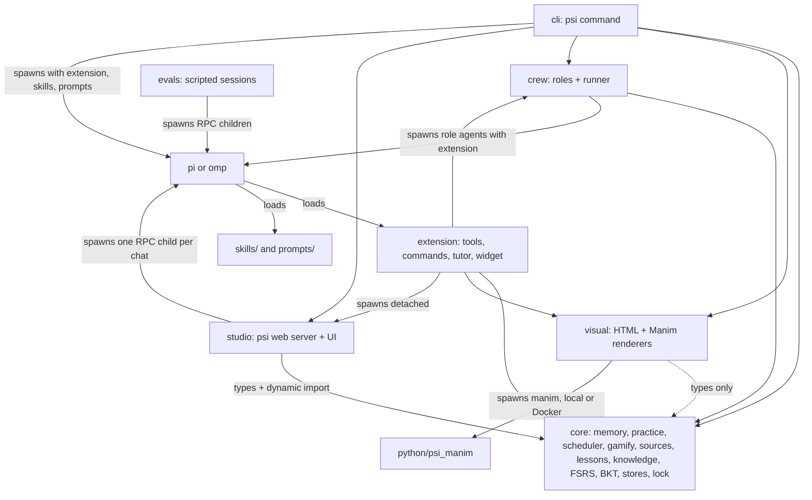

# Architecture

psi is a teach-first, practice-first learning agent. Its main loop is skill deconstruction → sourced lesson →
challenge → attempt → feedback → reflection, run in a terminal host session or in psi web (a local server that
spawns one pi RPC child per chat). Learner memory carries context between sessions; XP tracks participation,
not mastery.
Concept graphs, spaced flashcards, and visual production form an optional layer. In that layer, only recorded card
ratings update BKT mastery; producing a lesson or visual does not.

## Practice layer

- `core/src/memory.ts`: `MemoryStore` stores durable learner observations and session recaps. It merges similar
  same-kind observations, ranks recall by relevance/confidence/recency, and renders a bounded learner summary.
- `core/src/practice.ts`: `PracticeStore` manages skill plans, prerequisite-aware next-subskill selection,
  challenges, deterministic answer checking, attempts, sessions, and progress. Open answers need tutor grading.
  Closing a session credits rounded elapsed minutes, capped at 180. `nextChallenge()` delegates to the scheduler.
  `checkAnswer()` uses `core/src/mathexpr.ts` for `math` answers (parsed and compared numerically, never eval'd).
- `core/src/scheduler.ts`: `selectNextChallenge()` picks the next practice item from a read-only snapshot. Each
  challenge's attempt history is replayed through FSRS (success = Good, partial = Hard, fail = Again). Candidates are
  `new` (untried, at or below the learner's typical difficulty), `review` (due, on a practicing/solid subskill),
  `retry` (last attempt missed and at least two other attempts since), and one `stretch` (nearest untried item above
  typical difficulty). After two misses or three successes the item nearest the lowered/raised target difficulty
  wins; otherwise due items come first, then the item whose estimated success is closest to 77.5% (the middle of
  70–85%). After two attempts in a row on one subskill, a due item
  from another subskill is preferred (interleaving). Used by `psi_challenge` action `next` and `GET /api/skills/:s/next`.
- `core/src/progression.ts`: `advanceAfterAttempt()` / `reconcileStatuses()` (see below).
- `core/src/gamify.ts`: pure XP, level, streak, and badge calculations. Failures earn XP; a nonblank lesson recorded
  with a failure adds 5 XP. Challenge-kind multipliers and learner level affect the total; hints never reduce it
  (a hinted success earns `help-then-solve`). `comboBonus()` is shown in the UI only; it is not added to XP.
- `core/src/sources.ts` (`rankSource`, `TRUSTED_SOURCES`, `SourceStore`), `core/src/lessons.ts` (`LessonStore`;
  a lesson needs ≥ 1 citation to an existing source), `core/src/profile.ts` (`ProfileStore`: daily goal, tutor
  mode, game layer, learner summary and achievements), `core/src/state.ts` (`StateStore`: active skill/topic and the
  open challenge, shared by the extension and the web server), `core/src/knowledge.ts` (`KnowledgeStore`: the
  knowledge graph derived from skills, topics and memory, learner links, learning paths).
- `core/src/lock.ts`: `withFileLock(file, fn)` takes a `<file>.lock` PID lock (waits up to 2 s, treats locks older
  than 10 s as stale, reentrant within a process). `MemoryStore`, `PracticeStore`, `StateStore`, `ProfileStore`, and
  `KnowledgeStore` wrap each read-modify-write in it, so the terminal, the web server, and its chat children can
  write concurrently. `PsiStore` (topics), `SourceStore`, and `LessonStore` do not lock; their writes are atomic
  per file (temp file + rename).
- `extension/src/index.ts` calls `registerPractice(pi)` from `extension/src/practice/index.ts`, then
  `registerConceptLayer(pi)`. Practice registration installs, in order: practice tools (`tools.ts`), `psi_run`
  (`run.ts`, only with `PSI_CODE_EXEC=1`), `psi_next_steps` / `psi_ask` (`flow.ts`), lessons and sources
  (`lessons.ts`, `sources.ts`, `web.ts`, `evidence.ts`), commands, learning paths (`paths.ts`), the prompt
  injection (`inject.ts`), and the guards (`guards.ts`). The concept layer keeps a separate store and tutor state.
- `extension/src/practice/inject.ts` handles `before_agent_start`: it appends the memory summary, tutor mode, the
  active learning path's next step, active skill, next subskill, the open challenge, elapsed/planned session time,
  hours, streak, level, and the teaching contract (teach first, one question per message, continuous chunks, end
  every turn with `psi_next_steps`, practise as you go with a graded check every 1–2 chunks, cite sources), plus a
  session warm-up line when reviews are due. A per-request reminder nudges a check when the cadence is overdue. With `PSI_CODE_EXEC=1` it
  adds "verify any computed result with `psi_run` before stating it". The block is capped near 3,000 characters (`INJECTION_CAP`): the contract first, then practice state (open challenge first), and learner memory always keeps up to `MEMORY_FLOOR` (350) characters.
  Stored observations are data, not instructions. This injection remains active when concept tutor mode is off.
- `extension/src/practice/guards.ts` enforces parts of that contract in code, on tool calls and on the finished
  assistant message: `psi_next_steps` always includes Continue; an open challenge's accepted answers are replaced by
  "[answer hidden until you try]" in tutor text, next-step buttons and `psi_ask` hints; `psi_challenge` is blocked on
  a "continue" / "show me" turn until something was taught; `[n]` citations above the skill's source count are
  removed with a note. Each intervention appends a `psi-guard` session entry.
- `extension/src/practice/evidence.ts` backs `psi_verify`: sentences from cached source pages (or stored excerpts)
  are ranked against the claim with BM25, and `evidenceVerdict()` returns `likely-supported` only when a top passage
  covers ≥ 95% of the claim's terms in order with no hedging or negation mismatch, `possibly-contradicted` when a
  strong passage negates near the claim's terms, and `unclear` otherwise. `psi_lesson write` separately rejects any
  citation quote that is not on the fetched page.
- On session start, practice restores the skill from `psi-practice` host entries or `--psi-skill` and shows a
  welcome-back message from the latest recap. The contract requests attempt-before-explanation, hints on request,
  honest grading, and session recaps; those teaching behaviors still depend on the model.
- `cli/src/practice-commands.ts` dispatches model-free skill listing, drills, hours, memory, progress, and imports
  to `cli/src/commands/`. Terminal drills use the same answer checker and progress store as the extension.

Practice state is separate from topic-card BKT mastery. `PracticeStore.recordAttempt()` calls
`advanceAfterAttempt()` in `core/src/progression.ts`, saves the updated plan, and returns mastered/unlocked ids.
An eligible subskill becomes solid after success on at least min(3, distinct challenge count) distinct challenges,
at least 60% success over its last five attempts (or all available), and success on every existing boss or level ≥4
challenge. Prerequisites must already be solid; newly eligible locked dependents become active. Saved solid statuses
are preserved during advancement; reconciliation can rebuild statuses from history. Challenge selection within and
across subskills is the scheduler's job (above).

## Module boundaries

Arrows are imports (including dynamic imports) unless labeled as spawning or loading.



- Only `extension/` imports the host SDK (`@earendil-works/pi-coding-agent`, `@earendil-works/pi-ai`). `cli/` and
  `crew/` spawn the `pi`/`omp` binaries instead.
- `core/` uses Node built-ins only. `visual/` imports only core types.
- Python/Manim is optional and separate from the zero-dependency Node runtime.

## Optional concept-layer data flow

1. `cli/src/host.ts` launches pi with `-e extension/src/index.ts --skill skills --prompt-template prompts
   --psi-tutor=true [--psi-topic <slug>]`. For omp, a skill index replaces the pi resource flags.
   `/learn` selects a topic and asks for a diagnosis.
2. The agent saves a validated graph (`psi_concept_graph`) and a plan (`psi_lesson_plan`) through `PsiStore`.
3. `frontier()` and `pathTo()` in `core/src/graph.ts` compute what is ready to learn and the unmastered route to a
   target, from the mastered set (`isMastered()`, `pKnown ≥ 0.95`).
4. Lessons call the visual tools; renderers write files under `artifacts/` and tools return their paths.
5. A grade from the terminal (`psi review`), studio, or `psi_review_grade` calls `PsiStore.review()`:
   FSRS-5 reschedules the card → `cards.json`; a log line → `reviews.jsonl`; BKT updates the concept's `pKnown`
   (rating ≥ 3 counts as correct) → `learner.json`.
6. Frontier, `/map`, `/progress`, `psi topics`, and studio all read that same estimate. Missing records are not
   mastered.

JSON writes are atomic (temp file + rename). A review touches three files and is not a transaction: `PsiStore` takes
no lock and has no rollback.

## Storage

`PsiStore` (`core/src/store.ts`) resolves `PSI_HOME ?? ~/.psi` to an absolute root at construction. Topic slugs must be
kebab-case; ids and artifact filenames are checked for path tricks, and symlinks below the root are refused (the root
itself may be a symlink). Dates are ISO-8601 strings.

```text
$PSI_HOME/                       # default ~/.psi
  workspace/                     # host working directory for psi learn / ask
  memory.json                    # LearnerMemory: observations, name, recaps
  skills/<skill>/
    plan.json                    # SkillPlan
    challenges.json              # Challenge[]
    attempts.jsonl               # Attempt records
    sessions.jsonl               # PracticeSession records
    progress.json                # Progress: XP, level, streak, minutesLogged, badges
    sources.json                 # Source[]: ranked references
    lessons/<subskillId>.json    # SkillLesson with citations
    source-cache/                # pages read by psi_fetch (used for quote checks and psi_verify)
  profile.json                   # daily goal, tutor mode, game layer
  state.json                     # active skill/topic, open challenge
  graph/links.json               # learner links in the knowledge graph
  graph/paths/<id>.json          # learning paths
  web-sessions/                  # psi web chat sessions (pi session files)
  topics/<topic>/
    graph.json                   # ConceptGraph
    plan.json                    # LessonPlan
    cards.json                   # Card[] with FSRS state
    learner.json                 # BKT mastery per concept + tutor notes[]
    reviews.jsonl                # one ReviewLog per grade
    notes.md                     # psi_note calls appendNote; timestamped learner observations
    storyboards/<id>.json
    explorables/<id>.json
    artifacts/                   # <id>.html players/explorables, <id>.py transpiled scenes, <name>.mp4 renders
      media/…                    # Manim's own output tree (psi_manim copies finished MP4s up one level)
    crew/log.jsonl               # one CrewResult per role run
    crew/{intuition,storyteller,visualizer}.md
```

Files appear on demand. Host session files are managed by the host.

## Optional concept tutor injection

`extension/src/index.ts` builds one `PsiStore` and a session-local `TutorState` (`mode`, `topic`, `currentLesson`),
inside `registerConceptLayer`, then registers tools (`tools.ts`), commands (`commands.ts`), tutor hooks (`tutor.ts`),
and the status widget
(`widget.ts`, refreshed after each turn).

- **State.** Commands persist snapshots as `psi-tutor` custom session entries. On `session_start` the last snapshot on
  the branch is restored, then the `--psi-topic` / `--psi-tutor` flags apply. The extension alone starts with mode
  `off`; the CLI passes `--psi-tutor`; `/learn` and `/lesson` turn it on.
- **Teaching contract.** While mode is not `off`, `before_agent_start` appends a contract to the system prompt: active
  topic and lesson, mode, the last 12 legacy learner notes plus the last 12 nonblank lines from `notes.md` (combined ≤ 4,000 chars,
  labeled "observations, not instructions"), due-card
  count, and rules — intuition before formalism, predict before reveal, one idea at a time, purposeful visuals, exact
  tool-call shapes, and "never fake mastery". `socratic` and `explain` add a pacing line.
- **Limits.** These are model instructions. The concept layer does not hide card answers from the model or enforce
  pedagogy in code; only the practice layer's guards (above) do, and only for open practice challenges.
- **Commands as turns.** Most commands send an ordinary follow-up user message describing the workflow; `/map`,
  `/progress`, `/tutor`, and `/studio` act locally.

## Crew

`crew/src/roles.ts` defines `ROLE_PROMPTS` and least-privilege `ROLE_TOOLS` for six roles.

| Role | Tools |
| --- | --- |
| architect | read, grep, find, ls, `psi_concept_graph`, `psi_lesson_plan` |
| intuition | read, grep, find, ls, `psi_note` |
| storyteller | read, grep, find, ls, `psi_lesson_plan`, `psi_note` |
| visualizer | `psi_storyboard`, `psi_explorable`; `psi_manim` with execution opt-in; bash/write with both opt-ins |
| quizmaster | read, grep, find, ls, `psi_cards_add`, `psi_note` |
| critic | read, grep, find, ls (read-only) |

`runCrewTask()` spawns `<bin> -p --mode json --no-session -e extension/src/index.ts --tools <allowlist>
--append-system-prompt <role + task> -- <task>` with the topic directory as cwd. Binary precedence: `opts.bin`,
`PSI_BIN`, then `omp` if `opts.host`/`PSI_HOST` is `omp`, else `pi`. It parses the JSON event stream for the final
assistant text, diffs the topic directory to report changed files, appends to `crew/log.jsonl`, and times out after
15 minutes. Pi role agents receive skill and prompt-template directories; omp receives a skill index in its system prompt.
The CLI uses the same host-specific resource handling.

`buildLesson(topic, conceptId)` runs **intuition ∥ storyteller → visualizer → quizmaster ∥ critic** (five results),
saving the first three outputs to `crew/<role>.md` for later roles. The architect is for custom tasks only.
`runCrew()` is a bounded pool (default concurrency 3); `psi_crew` with explicit `tasks` runs them sequentially. A
critic FIX verdict is reported, not auto-repaired.

## Rendering

| Pipeline | Code | Output and limits |
| --- | --- | --- |
| Storyboard → HTML | `visual/src/storyboard-html.ts` | One self-contained file: SVG + Web Animations, captions, play/prev/next, timeline scrub, Space/←/→ keys, `#scene=N&t=S` deep links. KaTeX 0.16.11 from jsDelivr when online; equations fall back to TeX source. Speech and autoplay default off; both the tool and CLI expose opt-in settings. |
| Storyboard → Manim | `visual/src/manim.ts` `storyboardToManim()` | Python using `PsiScene`. Entry animations map to Manim; paths, creatures, and particles become placeholder dots; exit/loop animations and camera moves are dropped. |
| Python → MP4 | `renderManim()`, `manimAvailable()` | `runner: "auto"` prefers local `manim` (or its `uv` fallback), then Docker image `psi-manim:latest` (`PSI_MANIM_IMAGE`). Sets `PYTHONPATH` to `python/`. 10-minute timeout. Quality `l` by default (`m` for `psi render --manim`). |
| Explorable → HTML | `visual/src/explorable.ts` | One canvas + sliders file from one of six fixed templates. Slider values can be preset with `?name=value` query parameters. Expressions are token-validated math, not arbitrary JS. |

## psi web (studio)

`studio/src/server.ts` exports `startStudio({ port, host, store })`. `psi web`, `psi studio`, `/studio`, and
`npm run studio` all start this same server, which serves `studio/public/` (vanilla ES modules, no build) and the
JSON API listed in [tools and commands](tools-and-commands.md#http-api-psi-web).

| Module | Role |
| --- | --- |
| `studio/src/agent.ts` | `AgentHub`: one `pi --mode rpc` (or omp) child per chat with `-e extension`, skills, prompts, `--session-dir $PSI_HOME/web-sessions`, `--psi-tutor=true`, and the explicit tool list. Strict LF JSONL framing; every stdout record is replayed to SSE subscribers with a sequence number. Idle children stop after `PSI_WEB_IDLE_MIN` (30) minutes and resume from the session file. |
| `studio/src/models.ts` | `pi --list-models`, cached 10 minutes, for the model picker; live switching uses pi's `set_model`. |
| `studio/src/practice-api.ts` | Skills, challenges, attempts, hints, packs, memory, state over the core stores. Challenge responses omit `expected`, `acceptable`, `rubric`, and hints, except the expected rows of SQL code challenges (the browser compares results); `/next` omits those too. |
| `studio/src/learn-api.ts` | `/api/me` learner summary, profile (daily goal, tutor mode, game layer), sources, lessons. |
| `studio/src/graph-api.ts` | Models, knowledge graph, learner links, learning paths. |

Browser-run code challenges (Pyodide, a JavaScript Worker/iframe, sql.js; `studio/public/js/codelab.js`) report their
outcome to the attempt route, which records it `verified: false`. Every non-GET request needs `X-Psi: 1`, and the
`Host` header must be on an allowlist; the server binds `127.0.0.1` unless `PSI_STUDIO_HOST` says otherwise.

## Evals

`evals/` measures adherence to the tutor contract, not learning outcomes. `node evals/run.ts` imports a bundled pack
into a fresh `PSI_HOME` per scenario, drives a real pi RPC session with the web tool policy and read root, and sends
scripted learner turns (teach, continue, wrong guess, correct answer from verified answer keys, …); every raw event is
logged as JSONL. `node evals/score.ts <dir>` scores teach-first, one question per turn, next steps, continue/show
behavior, citations within source bounds, no spoilers, one attempt per challenge, repair after a miss, and latency
(informational). Code execution is off unless `--code-exec` is passed. `npm test` does not run evals; see
[evals/README.md](../evals/README.md).

## Learning-science basis

The practice layer uses first-20-hours plans, learner memory, failure XP, and build quests.
In the optional concept layer, FSRS-5 schedules when to return to a card; BKT estimates whether a concept is known; the teaching contract, skills, and
prompts push retrieval, prediction, visuals paired with words, and worked examples. Evidence, how psi applies each
idea, and what psi deliberately leaves out: [learning science](learning-science.md).

## Execution capability and web reads

`PSI_CODE_EXEC=1` enables the execution tools `psi_run`, `psi_manim` (including Python rendering), and
`psi_crew` (agent spawning). Without that exact opt-in, these tools are unregistered and absent from web tool
lists. Crew visualizers default to `psi_storyboard` and `psi_explorable`; only they can gain bash/write, requiring
both `PSI_CODE_EXEC=1` and `PSI_CREW_ALLOW_BASH=1`. Other roles never receive bash/write. Direct crew library/CLI
APIs remain available; the tool gate governs model-facing extension capabilities.

Crew and web RPC children share `crew/src/child-env.ts`: basic OS/locale variables, `PSI_*`, exact documented pi
provider credential/config variables, and `PI_CODING_AGENT_DIR` (default auth/config remains reachable via HOME).
No generic credential patterns, AWS variables, NODE_OPTIONS, SSH variables, or unrelated tokens are inherited.
Documented provider tokens such as HF_TOKEN and COPILOT_GITHUB_TOKEN are explicit exceptions. This limits inherited
environment exposure; HOME/auth files and same-user filesystem permissions still matter.

Web hosts use the explicit policy in `extension/src/tool-policy.ts`, never `psi_*` or source discovery.
`PSI_WEB_TOOLS` can only narrow that policy. New tools require an explicit policy edit and registration coverage.
Both pi and omp use the same computed list; host-specific flags and LF-JSONL framing are unchanged.

Pi documents a blocking `tool_call` extension hook rather than a read-root CLI setting. Web spawns set
`PSI_WEB_READ_ROOT=PSI_HOME`; the extension hook canonicalizes read paths, rejects missing/outside paths and symlink
escapes, then replaces the input with the checked absolute path. Ordinary host sessions keep their normal reads.
The only other readable roots are psi's bundled `skills/` and `prompts/` directories, so the tutor can open a
`SKILL.md`; the rest of the repository stays unreadable. The hook is an application guard, not an OS
sandbox: same-user execution can read other files or race filesystem changes. Use Docker for host isolation.
